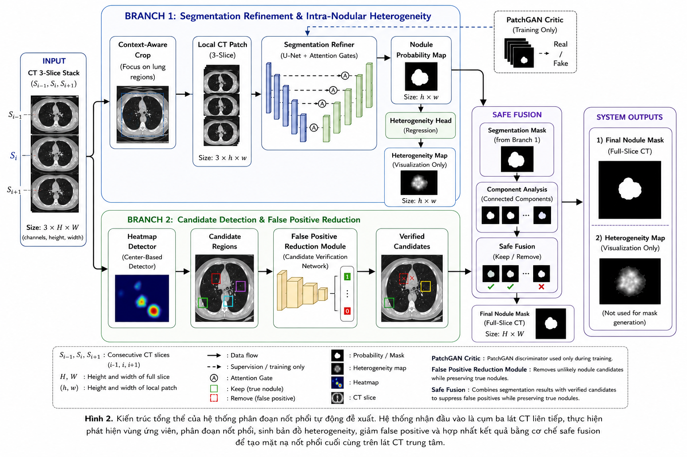
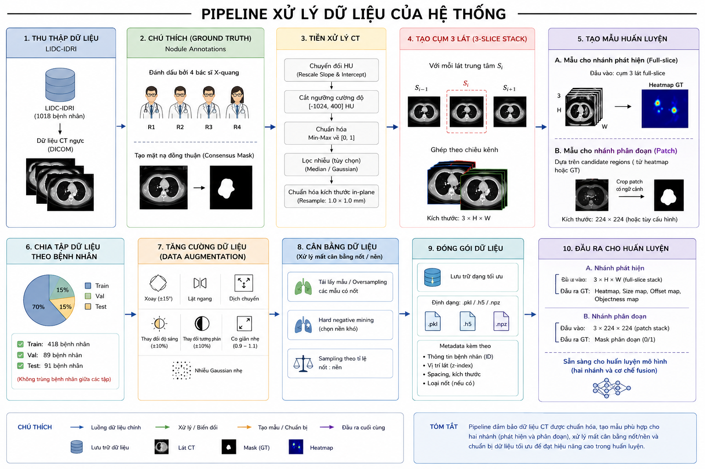
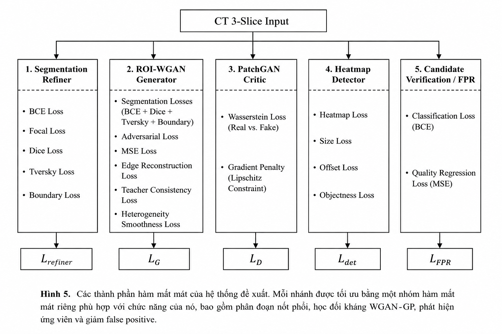

# Automatic Lung Nodule Segmentation and Intra-Nodular Heterogeneity Visualization

A deep learning project for automatic lung nodule segmentation from chest CT images and visualization of intra-nodular heterogeneity using the LIDC-IDRI dataset.

The system combines a segmentation refiner, ROI-WGAN branch, heatmap-based candidate detector, false-positive reduction, and safe fusion to generate lung nodule segmentation masks and heterogeneity maps.

## Overview

Lung nodule segmentation is challenging because nodules vary in size, shape, intensity, and location. Low-contrast boundaries and nodules adjacent to blood vessels or the pleura can make accurate segmentation difficult.

This project implements a multi-branch pipeline designed to:

- Automatically identify candidate regions containing lung nodules.
- Refine nodule boundaries using deep learning.
- Reduce false-positive predictions through candidate verification and component-level filtering.
- Generate intra-nodular heterogeneity maps for visualization.
- Combine complementary predictions through a safe fusion mechanism.

The inference pipeline is designed to operate without manually supplied ROIs or ground-truth coordinates. Module-level ROI experiments are reported separately from the complete automatic pipeline.

## Key Features

- **Automatic Lung Nodule Segmentation:** Predicts pixel-level nodule masks from CT images.
- **Three-Slice CT Input:** Uses three consecutive CT slices to incorporate neighboring-slice context.
- **Segmentation Refinement:** Combines multiple segmentation losses to improve overlap and boundary quality.
- **ROI-WGAN Branch:** Generates auxiliary segmentation predictions and heterogeneity maps.
- **Heatmap-Based Detection:** Proposes candidate regions across full CT slices.
- **False-Positive Reduction:** Verifies candidates and filters unreliable predicted components.
- **Safe Fusion:** Combines segmentation and candidate information to produce the final mask.
- **Quantitative Evaluation:** Uses Dice, IoU, Boundary F1, and additional detection and false-positive reduction metrics.

## System Architecture

The pipeline consists of complementary components:

1. **Segmentation Refiner:** Predicts the nodule probability map.
2. **ROI-WGAN Generator:** Produces auxiliary segmentation information and intra-nodular heterogeneity maps.
3. **PatchGAN Critic:** Provides adversarial training feedback through the WGAN-GP objective.
4. **Heatmap Detector:** Identifies candidate nodule locations on full-slice CT inputs.
5. **Candidate Verification and False-Positive Reduction:** Evaluates candidate reliability and reduces false-positive predictions.
6. **Safe Fusion:** Combines segmentation masks and verified candidate information to generate the final output.

The PatchGAN Critic is used during training rather than as a component of the final inference pipeline.

## Dataset

The project uses the **LIDC-IDRI** public lung CT dataset.

Nodule ground-truth masks are constructed from XML annotations. The preprocessing pipeline converts CT values to Hounsfield Units (HU), clips intensities to the range `[-1024, 400]`, normalizes values to `[0, 1]`, and constructs three-slice input stacks.

### Dataset Split

The reported experiment uses patient-level splitting to reduce data leakage between training, validation, and test sets.

| Split | Patients | Positive Samples | Negative Samples |
|---|---:|---:|---:|
| Training | 418 | 5,934 | 1,696 |
| Validation | 89 | 1,360 | 356 |
| Test | 91 | 1,428 | 372 |

Negative samples refer to samples without annotated nodules used for detector and false-positive reduction experiments.

The dataset must be obtained and prepared separately according to its applicable access and usage requirements. Raw CT data is not included in this repository.

## Methodology

### 1. Data Preprocessing

- Convert CT pixel values to HU using the scan rescale parameters.
- Clip HU values to `[-1024, 400]`.
- Normalize image intensities to `[0, 1]`.
- Construct three-slice CT stacks with the center slice as the segmentation target.
- Generate binary ground-truth masks from LIDC-IDRI annotations.
- Prepare full-slice samples for detection and contextual ROI patches for segmentation.
- Split the data by patient into training, validation, and test sets.

### 2. Segmentation Refiner

The segmentation refiner predicts a nodule probability map and focuses on overlap, foreground imbalance, and boundary accuracy.

The reported loss components include:

- Binary Cross-Entropy (BCE) Loss
- Focal Loss
- Dice Loss
- Tversky Loss
- Boundary Loss

### 3. ROI-WGAN and Heterogeneity Generation

The ROI-WGAN branch uses an adversarial learning objective to complement segmentation refinement. Its generator produces auxiliary segmentation information and an intra-nodular heterogeneity map.

The WGAN-GP objective includes a gradient penalty to encourage stable critic training.

The heterogeneity map is intended for visualization and qualitative analysis. It is **not** a validated biomarker, a benign-versus-malignant classifier, or a clinical diagnostic result.

### 4. Candidate Detection

The heatmap detector processes full-slice CT inputs and predicts candidate nodule locations. Candidate regions are extracted from high-response locations and used to guide subsequent verification and segmentation processing.

### 5. False-Positive Reduction

Candidate verification and component-level filtering are used to distinguish likely nodule predictions from false positives. The evaluation considers candidate classification quality as well as the risk of incorrectly removing true nodules.

### 6. Safe Fusion

The final fusion stage combines segmentation predictions with verified candidate information to produce the final nodule mask. Validation data is used for model selection and threshold or fusion calibration.

## Experimental Results

The following results are taken from the project's final PBL4 report.

### Segmentation Performance

| Configuration | Validation Dice | Test Dice | Test IoU | Test Boundary F1 |
|---|---:|---:|---:|---:|
| ROI Backbone | 0.8451 | 0.8501 | 0.7547 | 0.8547 |
| ROI-WGAN Branch | 0.8366 | 0.8370 | — | — |
| ROI + Branch 1 Fusion | 0.8453 | 0.8503 | 0.7550 | 0.8555 |
| Complete Two-Branch System | 0.8460 | **0.8506** | **0.7552** | 0.8545 |

The complete two-branch system was selected using validation performance. Its test Dice was 0.8506, with a reported 95% bootstrap confidence interval of `[0.8447, 0.8567]`.

The improvement over the ROI backbone was small: 0.0006 in mean test Dice. The report found no clear statistically significant improvement in this comparison (Wilcoxon `p = 0.9887`).

**Important evaluation note:** ROI-based ablation results measure segmentation performance when the ROI has already been well localized. They should not be interpreted as equivalent to end-to-end automatic segmentation performance.

### Detection and False-Positive Reduction

| Metric | Test Result |
|---|---:|
| Detector Top-5 GT containment | 96.15% |
| Candidate FPR AUC | 0.9881 |
| Candidate FPR Precision | 0.9100 |
| Candidate FPR Recall | 0.9769 |
| Candidate FPR Specificity | 0.9034 |

Candidate FPR classification metrics are reported at a threshold of 0.50. Detector containment and candidate classification measure different parts of the pipeline and should be interpreted separately from final segmentation metrics.

## Training Configuration

The final experiment reported in the project report used the following configuration:

| Parameter | Setting |
|---|---|
| Framework | PyTorch |
| Reported environment | PyTorch 2.10.0+cu128 |
| Training platform | Kaggle |
| GPU | NVIDIA Tesla T4 |
| ROI patch size | 224 × 224 |
| Input depth | 3 CT slices |
| Batch size | 8 |
| Refiner learning rate | 1 × 10⁻⁴ |
| Main refiner training | 36 epochs |
| Auxiliary LNHG++ branches | 20 epochs |

These settings describe the reported experiment. Actual reproducibility also depends on dataset preparation, configuration values, model checkpoints, and the installed software environment.

## Repository Structure

```text
LNHG-lung-nodule-segmentation/
├── docs/
│   └── PBL4_Report.pdf
├── images/
│   ├── data-preprocessing-pipeline.png
│   ├── loss-functions-overview.png
│   ├── outputheterogeneity.png
│   ├── resultssegmentation.png
│   └── system-architecture.png
├── notebooks/
│   └── lnhg-lidcidri.ipynb
├── README.md
└── requirements.txt
```

## Getting Started

### Requirements

- Python environment compatible with the notebook.
- Jupyter Notebook or JupyterLab.
- PyTorch and the other Python libraries listed in `requirements.txt`.
- Access to the LIDC-IDRI dataset.
- Sufficient memory and compute resources for processing CT volumes and training deep learning models.

A CUDA-compatible GPU is recommended for training.

### 1. Clone the Repository

```bash
git clone https://github.com/duypear/LNHG-lung-nodule-segmentation.git
cd LNHG-lung-nodule-segmentation
```

Replace the repository URL if your GitHub username or repository name differs.

### 2. Create a Virtual Environment

```bash
python -m venv .venv
```

Activate it on Windows:

```powershell
.venv\Scripts\Activate.ps1
```

Or on Linux/macOS:

```bash
source .venv/bin/activate
```

### 3. Install Dependencies

```bash
python -m pip install --upgrade pip
pip install -r requirements.txt
```

Verify that the installed PyTorch version and CUDA configuration are compatible with your environment.

### 4. Prepare the Dataset

Obtain the LIDC-IDRI data through its authorized distribution source. Follow the dataset preparation and annotation-processing steps implemented in the notebook.

Update dataset paths to match your local environment. The raw CT dataset is not included in this repository.

### 5. Open the Notebook

```bash
jupyter notebook notebooks/lnhg-lidcidri.ipynb
```

Run the notebook cells in the required order after configuring the dataset paths and environment.

Training or inference may require additional data files, model checkpoints, or configuration files generated by earlier notebook cells. Confirm these dependencies before running the workflow from a clean environment.

## Images

### System Architecture



### Data Preprocessing Pipeline



### Loss Functions Overview



### Segmentation Results


### Intra-Nodular Heterogeneity


## Limitations and Future Work

- Evaluation is based on LIDC-IDRI; external multi-center validation has not been reported.
- End-to-end performance depends on automatic ROI detection and candidate selection.
- ROI-based ablation results can overestimate performance relative to fully automatic inference.
- False-positive filtering must balance removing erroneous components against accidentally removing true nodules.
- Heterogeneity maps require further validation and must not be interpreted as clinical diagnostic evidence.
- Future work includes improving candidate localization, evaluating generalization across CT acquisition settings, and investigating more robust multi-slice or volumetric approaches.

## Disclaimer

This project is an academic research prototype for medical image analysis. It is not a medical device and must not be used as a substitute for professional medical evaluation or diagnosis.

## Reference

Song, J. et al. “Automatic Lung Nodule Segmentation and Intra-Nodular Heterogeneity Image Generation.” *IEEE Journal of Biomedical and Health Informatics*, vol. 26, no. 6, pp. 2570–2581, June 2022. DOI: [10.1109/JBHI.2021.3135647](https://doi.org/10.1109/JBHI.2021.3135647).

## License

No license has been specified yet. Add a `LICENSE` file if you intend to permit others to use, modify, or redistribute this project.